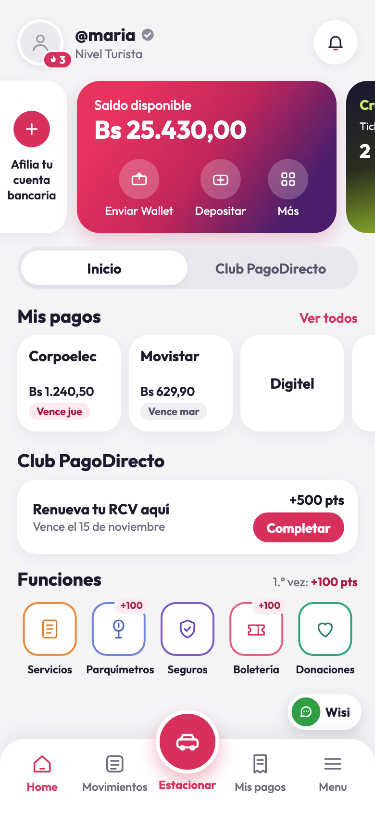
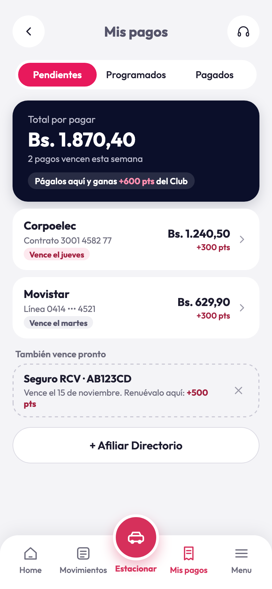
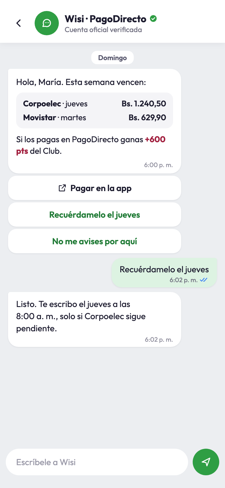
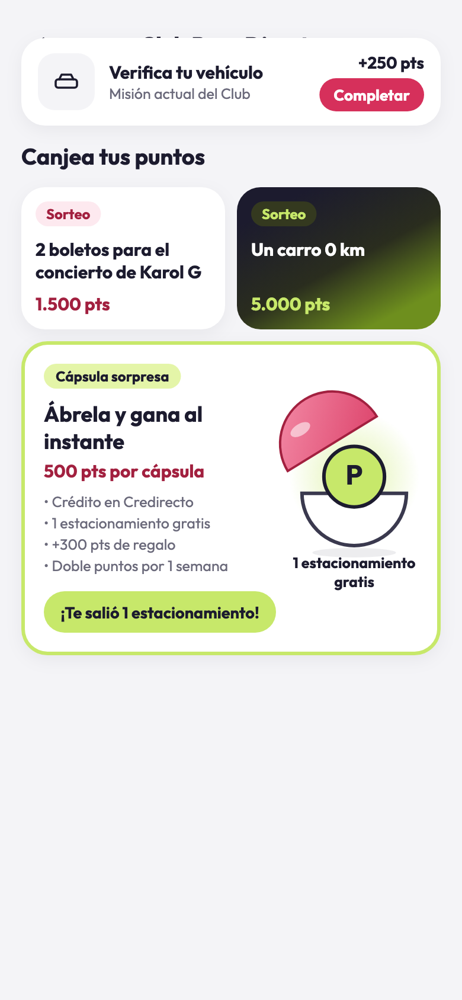

# PagoDirecto · Ruta Directa — demo de UI

Demo navegable de la propuesta **«Ruta Directa»** para el hackatón *GtM Venta Cruzada* de PagoDirecto.

La idea: que quien usa PagoDirecto solo para estacionar descubra que también puede pagar sus servicios (luz, teléfono, seguro) y ganar puntos del Club. Todo con avisos que respetan su tiempo: **nunca mientras maneja** y **un solo resumen a la semana**.

> **Solo frontend.** Es una app Flutter con datos simulados: no hay backend, ni pagos reales, ni notificaciones o WhatsApp reales. Todo lo que se ve (totales, puntos, racha, premios) se calcula en la propia app y cuadra en todas las pantallas.

<p align="center">
  
  
  
  
</p>

## Índice

1. [Cómo ejecutarla](#1-cómo-ejecutarla)
2. [Guion de la demo](#2-guion-de-la-demo)
3. [Pantallas](#3-pantallas)
4. [Qué cambiamos respecto al mockup](#4-qué-cambiamos-respecto-al-mockup)
5. [Datos de la demo](#5-datos-de-la-demo)
6. [Arquitectura](#6-arquitectura)
7. [Qué hace cada archivo](#7-qué-hace-cada-archivo)
8. [Pruebas y capturas](#8-pruebas-y-capturas)
9. [Historial de cambios](#9-historial-de-cambios)
10. [Pendientes](#10-pendientes)

---

## 1. Cómo ejecutarla

**Requisitos:** Flutter 3.44 o superior (Dart 3.12). No necesita conexión: la fuente Outfit y los iconos van dentro de la app.

```bash
cd gtm_ventacruzada
flutter pub get
flutter run -d chrome        # web; o -d <dispositivo> para Android / iOS
```

- **En el navegador o el proyector:** si la ventana mide 600 px o más de ancho, la app se dibuja dentro de un teléfono de 390×844.
- **Enlaces directos:** cada pantalla tiene su ruta, por ejemplo `http://localhost:<puerto>/#/club` o `/#/inicio?perfil=carlos`.
- **Menú de demo:** se abre con la pestaña **Menu** de la barra inferior o con una pulsación larga sobre el avatar del Inicio. Desde ahí se puede:
  - cambiar entre **María** y **Carlos**;
  - forzar los estados *cargando* y *error* de Mis pagos;
  - hacer fallar la búsqueda de factura;
  - saltar a cualquier pantalla o abrir el catálogo de componentes;
  - **reiniciar la demo**.

> Si se agregan archivos nuevos a `assets/` con la app en marcha, hay que **detener y volver a ejecutar** `flutter run`: la recarga en caliente no los sirve en la web.

## 2. Guion de la demo

Unos 3 minutos:

1. **Inicio de María:** sin publicidad. Arriba está lo que vence (Corpoelec el jueves, Movistar el martes), debajo una sola misión del Club y luego las funciones.
2. **La campana abre el resumen semanal:** un solo aviso el domingo a las 6:00 p. m., el día y la hora que ella eligió.
3. **Wisi por WhatsApp:** no habla de deudas. Engancha con un premio («con 1.000 pts puedes canjear un boleto para el concierto de Karol G») y «Más información» lleva al Club.
4. **Mis pagos:** un toque paga la semana y lleva a **Tu semana está al día**: +600 pts, la racha pasa de 3 a 4 semanas y gana un estacionamiento sin comisión.
5. **Club:** sorteos (Karol G y un carro 0 km) y la **Cápsula sorpresa**, que se abre ahí mismo y entrega el premio al instante.
6. **Estacionar:** el premio se aplica solo y «nada más se agrega» a ese pago. La salida no muestra ningún aviso.
7. **Tus avisos:** «Nunca mientras manejo» está siempre activo; el día, la hora y los canales del resumen se pueden cambiar.
8. **Carlos (solo estaciona):** «Registra tu servicio» encuentra su factura y le da +200 pts por su primer servicio.

## 3. Pantallas

Las once pantallas del mockup, desde «1 · Inicio ordenado». La pantalla «Antes · inicio actual» **no se construye**: es la referencia del problema.

| # | Pantalla | Ruta | Qué se puede hacer |
|---|---|---|---|
| P1 | Inicio · María | `/inicio` | Carrusel de saldo, Mis pagos con vencimientos, misión destacada, Funciones (+100 pts la 1.ª vez), botón de Wisi |
| P2 | Inicio · Carlos | `/inicio?perfil=carlos` | La misma pantalla, alimentada por otros datos: «Registra tu servicio · +200 pts» va primero |
| P3 | Añadir directorio | `/mis-pagos/afiliar` | Hoja inferior: servicio, contrato, búsqueda simulada de la factura, alias y «Listo» |
| P4 | Resumen semanal | `/resumen` | Pantalla de bloqueo simulada. La fecha y la hora salen de P8; la notificación abre Mis pagos |
| P5 | Wisi por WhatsApp | `/wisi` | Chat simulado: premio como gancho y «Más información» al Club |
| P6 | Mis pagos | `/mis-pagos` | Pendientes, Programados y Pagados; total por pagar, sugerencia descartable y afiliar |
| P7 | Tu semana está al día | `/mis-pagos/listo` | Lo pagado, el premio de la racha y el avance del Club |
| P8 | Tus avisos | `/avisos` | Resumen semanal (día y hora), canales y categorías |
| A1 | Club PagoDirecto | `/club` | Nivel y racha, misiones, sorteos y Cápsula sorpresa |
| A2 | Estacionar · pago | `/estacionar` | Detalle, «Pagas hoy», método de pago (PagoDirecto o Credirecto) y Confirmar |
| A3 | Salida | `/estacionar/listo` | Confirmación limpia, sin avisos mientras maneja |
| — | Catálogo | `/catalogo` | Herramienta interna: todos los componentes de la fase 1 juntos |

Las capturas finales de cada pantalla están en [`gtm_ventacruzada/docs/capturas/final/`](gtm_ventacruzada/docs/capturas/final/). Tienen los mismos nombres que las del mockup en [`gtm_ventacruzada/docs/mockups/`](gtm_ventacruzada/docs/mockups/), así que se pueden comparar una a una.

## 4. Qué cambiamos respecto al mockup

### 4.1 Reproducido tal cual

Las pantallas reproducen el HTML del mockup al píxel:
- **Marca:** tipografía Outfit, colores, degradados y sombras de la marca.
- **Textos:** los mismos que el mockup, incluidos «Home» y «Menu» en la barra inferior y el uso de «Bs.» en Mis pagos y de «Bs» en el resto.
- **Medidas:** tamaños y márgenes iguales al HTML.

Para lograrlo se corrigieron dos diferencias entre Flutter y el navegador (más detalle en el apartado 6):
- el alto de línea de Outfit se fija en 1,26, el «normal» del navegador;
- se quita el espaciado entre letras de 0,25 que Material 3 añade al texto de cuerpo.

### 4.2 Wisi: del cobro al premio (P5)

| Antes (mockup) | Ahora |
|---|---|
| «Esta semana vencen: Corpoelec Bs. 1.240,50 · Movistar Bs. 629,90…» | «¡Hola, Carlos! ¿Sabías que con **1.000 pts** puedes canjear **un boleto para el concierto de Karol G**? Si pagas tus servicios con PagoDirecto, cada pago te suma **puntos en el Club.**» |
| Tres respuestas: Pagar en la app · Recuérdamelo el jueves · No me avises por aquí | Un solo botón: **Más información**, que abre el Club |
| Fondo gris | Fondo blanco |

**Por qué:** un mensaje que empieza por lo que debes incomoda. Uno que empieza por lo que puedes ganar invita a entrar. Además, WhatsApp muestra los mensajes en la pantalla de bloqueo, así que es mejor que los montos no salgan del chat. El nombre del saludo cambia según el perfil (María o Carlos).

### 4.3 Club: sorteos y Cápsula sorpresa (A1)

- **Sorteos** en lugar de los canjes del mockup: «2 boletos para el concierto de Karol G · 1.500 pts» y «Un carro 0 km · 5.000 pts». Al tocar uno se descuentan los puntos y la etiqueta cambia de «Sorteo» a «Participando». Si no alcanzan los puntos, la app dice cuántos faltan.
- **Cápsula sorpresa** (500 pts por cápsula). **Se abre en la misma pantalla:** la cápsula tiembla, la tapa rosada salta y el premio sale con un rebote. El botón muestra el resultado; un toque más cierra la cápsula sin cobrar para poder abrir otra. Siempre se gana algo:

| Premio | Probabilidad | Qué pasa en la app |
|---|---|---|
| Crédito en Credirecto | 20 % | +1 ticket de Credirecto |
| 1 estacionamiento gratis | 25 % | El próximo estacionamiento cuesta Bs 0,00: A2 muestra la línea «Cápsula sorpresa · estacionamiento gratis» |
| +300 pts de regalo | 40 % | +300 pts en el Club |
| Doble puntos por 1 semana | 15 % | Los pagos de servicios dan el doble (+600 pts por factura en Mis pagos) |

> Primero se probó una **ruleta** en una pantalla aparte. Se reemplazó por la cápsula porque el efecto debía verse en la misma pantalla del Club.

### 4.4 Huecos del mockup que se completaron

- **Navegación completa** entre todas las pantallas, siguiendo los enlaces del HTML.
- **Pestañas «Programados» y «Pagados»** de Mis pagos, con estados vacíos.
- **Estados de carga y de error** en Mis pagos: barras grises sin brillo animado, y error dentro del bloque con «Reintentar».
- **Premios conectados entre pantallas:**
  - el premio de la racha de P7 («tu próximo estacionamiento no paga el servicio PagoDirecto») se aplica en A2: «Servicio PagoDirecto · premio de tu racha», Bs 0,00;
  - el estacionamiento gratis de la cápsula también se aplica en A2.
- **«Tus avisos» manda de verdad:** cambiar el día o la hora cambia la pantalla de bloqueo, y apagar el resumen la deja en pausa.
- **Misiones del Club:**
  - «Paga tu Corpoelec aquí» lleva a Mis pagos y desaparece cuando se paga;
  - las demás se completan al tocarlas y suman sus puntos.
- **Funciones:** la 1.ª vez suman +100 pts; las secciones que no forman parte de la demo muestran un aviso breve.
- **Silencio al manejar:** después de pagar el estacionamiento, la app no muestra ningún aviso.

### 4.5 Lo que no se construyó

- La pantalla «Antes · inicio actual».
- Backend, autenticación, pagos o notificaciones reales.
- Las secciones que el mockup no diseña: Movimientos, Enviar Wallet, Depositar, Credirecto, Soporte, etc. Muestran «no forma parte de la demo».

## 5. Datos de la demo

La fecha simulada es el **domingo 1 de noviembre de 2026, 6:00 p. m.** Todo está en [`datos_demo.dart`](gtm_ventacruzada/lib/datos/datos_demo.dart).

| Dato | María | Carlos |
|---|---|---|
| Saldo PagoDirecto | Bs 25.430,00 | Bs 3.120,00 |
| Tickets Credirecto | 2 | 2 |
| Racha | 3 semanas al día | 1 semana |
| Puntos del Club | 1.250 (siguiente nivel: 2.000) | 250 |
| Pagos pendientes | Corpoelec · Bs 1.240,50 · jueves 5 nov · +300 pts<br>Movistar · Bs 629,90 · martes 3 nov · +300 pts | ninguno |
| Misión destacada | Renueva tu RCV aquí · +500 pts | Verifica tu vehículo · +250 pts |

**Las cifras cuadran** (lo comprueban las pruebas):
- Total por pagar: 1.240,50 + 629,90 = **Bs 1.870,40**.
- Puntos al pagar: 300 + 300 = **+600 pts**, y 1.250 + 600 = **1.850 pts**, así que faltan **150** para el siguiente nivel.
- Estacionamiento: 1.241,60 + 413,87 = **Bs 1.655,47** (comprobante PD-48213). Con el premio de la racha baja a **Bs 1.241,60**; con la cápsula, a **Bs 0,00**.

## 6. Arquitectura

```
lib/
  main.dart            arranque
  app/                 aplicación, rutas, marco de teléfono, menú de demo, avisos
  tema/                tokens de diseño, tema Material y formato (Bs, fechas, horas)
  componentes/         piezas reutilizables (botones, barra inferior, interruptores…)
  datos/               modelos, datos de demo y DemoStore (el «backend» simulado)
  pantallas/           una carpeta por pantalla del mockup
```

- **Una sola fuente de verdad.** `DemoStore` (un `ChangeNotifier` expuesto con `InheritedNotifier`) guarda los perfiles y hace todas las cuentas: pagar, afiliar, abrir cápsulas, sorteos, misiones, ajustes y chat. Ninguna pantalla escribe una cifra a mano.
- **Rutas con `go_router`.** Inicio y Mis pagos comparten la barra inferior (`ShellRoute`). Añadir directorio es una hoja inferior con ruta propia. Una consulta `?perfil=` cambia de perfil al abrir un enlace.
- **Fidelidad al HTML.** Tres funciones de [`tokens.dart`](gtm_ventacruzada/lib/tema/tokens.dart) traducen el CSS del mockup:
  - `letra()`: tamaño, peso y color, con alto de línea 1,26 y espaciado 0;
  - `sombraCss()`: convierte `box-shadow` al radio de desenfoque de Flutter;
  - `degradadoCss()`: convierte `linear-gradient(<grados>deg, …)`.
- **Funciona sin red.**
  - La fuente Outfit va en `assets/fonts` (licencia OFL).
  - Los 37 iconos del mockup están escritos como SVG dentro del código, en `icono.dart`. La web no tiene que descargar ningún icono: antes, uno añadido con la app en marcha daba un 404 que congelaba la depuración.
- **Accesibilidad.**
  - Todo control tiene semántica y nombre.
  - El área táctil mínima es de 44 px.
  - Se respeta «reducir movimiento».
  - Las pruebas comprueban que nada se desborda a 360, 390 y 430 px de ancho.

## 7. Qué hace cada archivo

Todas las rutas son relativas a `gtm_ventacruzada/`.

### Raíz del proyecto

| Archivo | Para qué sirve |
|---|---|
| `pubspec.yaml` | Dependencias (`go_router`, `flutter_svg`, `flutter_localizations`) y la fuente Outfit (pesos 300 a 700) |
| `pubspec.lock` | Versiones exactas de las dependencias |
| `analysis_options.yaml` | Reglas de `flutter_lints` y ancho de línea de 120 para `dart format` |
| `README.md` | Texto por defecto de Flutter. La documentación está en este archivo de la raíz del repositorio |
| `android/`, `ios/`, `macos/`, `web/`, `windows/` | Proyectos de cada plataforma generados por Flutter. No se modificaron |

### `lib/` · aplicación

| Archivo | Para qué sirve |
|---|---|
| `main.dart` | Punto de entrada: arranca `AppPagoDirecto` |
| `app/app.dart` | `MaterialApp.router` con el tema, el español de Venezuela (`es_VE`), el `DemoStore` y el marco de teléfono. Acepta un store y una ruta inicial para las pruebas |
| `app/rutas.dart` | Todas las rutas (el mapa de navegación) y `ContenedorPrincipal`, la pantalla con barra inferior de Inicio y Mis pagos |
| `app/marco_demo.dart` | En pantallas de 600 px o más dibuja la app dentro de un teléfono de 390×844 |
| `app/menu_demo.dart` | Menú de la demo: perfil, estados forzados, atajos a cada pantalla y reinicio |
| `app/avisos_demo.dart` | Avisos breves (snackbars), incluido «no forma parte de la demo». Se silencian mientras la persona maneja |

### `lib/tema/` · diseño

| Archivo | Para qué sirve |
|---|---|
| `tokens.dart` | Colores (`PdColor`), escala de texto, espacios, radios, duraciones, degradados y las funciones `letra`, `sombraCss` y `degradadoCss` |
| `tema.dart` | `ThemeData`: sin el morado por defecto de Material, sin ondas de tinta, snackbars y transiciones de página |
| `formato.dart` | Formato único: `bs()` → «Bs 1.240,50», `bsPunto()` → «Bs. 1.240,50», puntos, miles, fechas («Vence el jueves») y horas («6:00 p. m.», con espacios que no se cortan) |

### `lib/componentes/` · piezas reutilizables

| Archivo | Para qué sirve | Dónde se usa |
|---|---|---|
| `presionable.dart` | Respuesta común a todo toque: escala breve, anillo de foco con teclado y semántica de botón | Todas las pantallas |
| `icono.dart` | `IconoPd` y el enum `Ico`: los 37 iconos del mockup como SVG dentro del código | Todas las pantallas |
| `barra_inferior.dart` | Barra Home · Movimientos · Estacionar · Mis pagos · Menu, con el botón rosado elevado | Inicio y Mis pagos |
| `segmentado.dart` | Control segmentado con pulgar deslizante (Inicio/Club; Pendientes/Programados/Pagados) | Inicio, Mis pagos, menú |
| `interruptor.dart` | Interruptor verde y `FilaInterruptor`, una fila de ajustes que se toca entera | Tus avisos, menú |
| `hoja_inferior.dart` | Hojas inferiores: `HojaPd`, `mostrarHojaPd` y `PaginaHoja` (una hoja con ruta propia) | Añadir directorio, selectores, menú |
| `encabezado.dart` | `EncabezadoSimple` (flecha y título centrado) y `EncabezadoPd` | Club, Tus avisos, Estacionar |
| `avatar_racha.dart` | Avatar con la insignia de la racha | Inicio |
| `barra_progreso.dart` | Barra de avance del nivel, con animación opcional | Club, Semana al día |
| `boton.dart` | `BotonPd` y `BotonIconoPd` | Menú de demo, catálogo |
| `tarjeta.dart`, `pastilla.dart`, `fila_pago.dart`, `selector.dart`, `campo.dart`, `burbuja_chat.dart` | Componentes genéricos de la fase 1 (tarjeta, píldoras, fila de pago, selector, campo de texto, burbujas de chat) | Solo el catálogo. Las pantallas usan versiones propias con los valores exactos del mockup |

### `lib/datos/` · datos y lógica

| Archivo | Para qué sirve |
|---|---|
| `modelos.dart` | Modelos: `Pago`, `Sugerencia`, `Mision`, `Canje` (sorteo), `PremioCapsula`, `AjustesAvisos`, `MensajeChat`, `TicketEstacionamiento`, `ResultadoPago`, `Funcion` (los 5 accesos con sus colores) y `Perfil` (estado de una persona) |
| `datos_demo.dart` | Datos de María y Carlos, fecha simulada, ticket del estacionamiento, sorteos, premio de Wisi y facturas que «encuentra» la búsqueda |
| `demo_store.dart` | `DemoStore`, el «backend» simulado: pendientes ordenados, totales, puntos (con doble puntos), pagar, afiliar, buscar factura, misiones, sorteos, Cápsula sorpresa, ajustes, chat de Wisi, pago del estacionamiento y estados forzados. `Demo` lo expone al árbol de widgets |

### `lib/pantallas/` · una carpeta por pantalla

| Archivo | Pantalla |
|---|---|
| `inicio/pantalla_inicio.dart` | P1 y P2: encabezado, carrusel, Mis pagos, misión destacada, Funciones y botón de Wisi. También el `BotonCompletar` de las misiones |
| `mis_pagos/pantalla_mis_pagos.dart` | P6: pestañas, tarjeta «Total por pagar», filas de pago, sugerencia con borde punteado, afiliar y estados vacío, de carga y de error |
| `mis_pagos/hoja_afiliar.dart` | P3: hoja «Añadir directorio» con búsqueda simulada de la factura (encontrada, buscando o error) |
| `mis_pagos/pantalla_semana_al_dia.dart` | P7: lo pagado, el premio y el progreso del Club |
| `resumen_semanal/pantalla_resumen_semanal.dart` | P4: pantalla de bloqueo con la notificación semanal |
| `wisi/pantalla_wisi.dart` | P5: chat con Wisi (mensaje del premio, «Más información», campo de texto) |
| `avisos/pantalla_avisos.dart` | P8: «Nunca mientras manejo», resumen semanal, canales y categorías |
| `club/pantalla_club.dart` | A1: tarjeta de nivel, misiones y sorteos |
| `club/capsula_sorpresa.dart` | Tarjeta y animación de la Cápsula sorpresa: la cápsula se dibuja con código y el premio se entrega en la misma pantalla |
| `estacionar/pantalla_estacionar.dart` | A2: pasos, detalle (con premio de racha o estacionamiento gratis), «Pagas hoy», métodos de pago y Confirmar |
| `estacionar/pantalla_salida.dart` | A3: confirmación y «Salir del estacionamiento» |
| `catalogo/pantalla_catalogo.dart` | Catálogo de componentes de la fase 1, para revisión interna |

### Pruebas, herramientas, recursos y documentación

| Archivo | Para qué sirve |
|---|---|
| `test/widget_test.dart` | 14 pruebas: formato, cifras, cápsula, recorridos completos y desbordes a tres anchos |
| `test/fuentes.dart` | Carga Outfit en las pruebas. Sin ella, Flutter dibuja el texto con glifos cuadrados y aparecen desbordes falsos |
| `tool/capturas_test.dart` | Genera las capturas a 390×844, o al ancho que se le indique, en `docs/capturas/final/` |
| `assets/fonts/Outfit-*.ttf` | Fuente Outfit, pesos Light a Bold (licencia OFL) |
| `docs/PLAN_UI.md` | Plan de trabajo por fases, inventario de pantallas, decisiones y criterios de aceptación |
| `docs/mockups/` | Capturas del mockup original (referencia) |
| `docs/capturas/final/` | Capturas de la app terminada, con los mismos nombres que el mockup |

## 8. Pruebas y capturas

```bash
cd gtm_ventacruzada
flutter analyze                                          # sin avisos
flutter test                                             # 14 pruebas
flutter test tool/capturas_test.dart --update-goldens    # capturas a 390 px
flutter test tool/capturas_test.dart --update-goldens --dart-define=ANCHO=360
```

Lo que cubren las pruebas:

- **Formato:** bolívares con miles y decimales; horas en español de Venezuela.
- **Cifras:** el total y los puntos de María cuadran, y pagar todo sube la racha y activa el premio.
- **Cápsula sorpresa:** las probabilidades suman 100 %, cuesta 500 pts y el premio se aplica (por ejemplo, el estacionamiento queda en Bs 0,00).
- **Doble puntos:** duplica los puntos que se ganan al pagar.
- **Primer servicio:** Carlos gana +200 pts.
- **Recorridos completos:**
  - María: Inicio → Mis pagos → pagar → semana al día;
  - estacionar con el premio de la racha y salir sin avisos;
  - Carlos registra su primer servicio;
  - Wisi sin montos y «Más información» al Club;
  - la cápsula se abre en el mismo Club;
  - el resumen semanal sigue los ajustes de Tus avisos.
- **Desbordes:** ninguna pantalla se desborda a 360, 390 ni 430 px.

Las capturas se generan con el renderizador de pruebas de Flutter porque Chrome sin interfaz no baja de unos 500 px de ancho. Usan una semilla fija, así que la cápsula siempre muestra «1 estacionamiento gratis».

## 9. Historial de cambios

1. **Plan** ([`docs/PLAN_UI.md`](gtm_ventacruzada/docs/PLAN_UI.md)): fases, inventario de pantallas, huecos del mockup y decisiones de diseño.
2. **Base:**
   - tokens de diseño y componentes;
   - datos simulados con `DemoStore`;
   - todas las rutas;
   - menú de demo y marco de teléfono.
3. **Las 11 pantallas, fieles al mockup:**
   - se reprodujeron los colores, degradados, sombras y textos del HTML;
   - se fijaron el alto de línea y el espaciado de Outfit;
   - se escribieron pruebas de recorridos y de desbordes.
4. **Iconos dentro del código:** se corrigió que la página del Club se quedara congelada en la web por un icono que no llegaba (404).
5. **Wisi** cambia el resumen de deudas por el gancho del premio de Karol G.
6. **Ruleta del Club** en una pantalla aparte. *Se reemplazó en el paso 7.*
7. **Sorteos y Cápsula sorpresa** dentro del Club:
   - los premios tienen efecto real: estacionamiento gratis en A2, doble puntos y ticket de Credirecto;
   - se eliminaron la ruleta y su pantalla.

## 10. Pendientes

- **Wisi y el Club no coinciden en Karol G.** Wisi dice «con 1.000 pts puedes canjear un boleto», pero el Club ofrece un **sorteo de 2 boletos por 1.500 pts**. Hay que unificar el mensaje.
- **La notificación de la pantalla de bloqueo (P4)** todavía dice «Esta semana vencen Corpoelec (jueves) y Movistar (martes)…». ¿Se pasa al mismo tono de premio que Wisi?
- **La cápsula es aleatoria en la app.** Si en la presentación conviene un resultado fijo, se puede añadir un interruptor al menú de demo.
- **Limpieza:** los componentes genéricos que solo usa el catálogo y el `README.md` por defecto de `gtm_ventacruzada/` se pueden borrar o actualizar.
