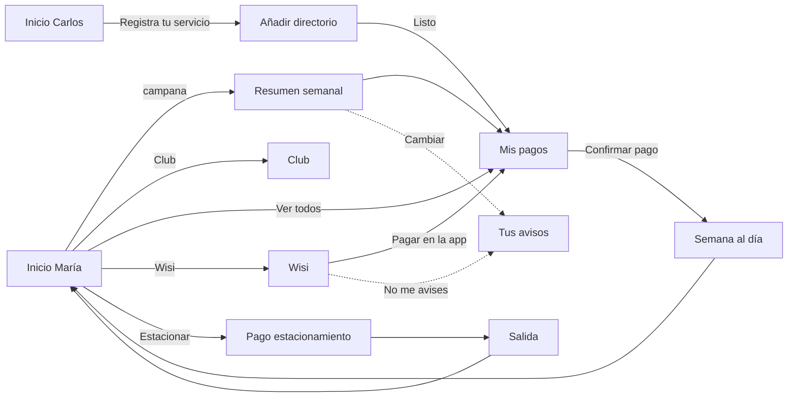

# Plan de implementación de la UI · PagoDirecto «Ruta Directa»

> Estado (31-oct-2026): **las 11 pantallas están terminadas**. Capturas a 390×844 en [`docs/capturas/final/`](capturas/final/), con los mismos nombres que [`docs/mockups/`](mockups/) para compararlas una a una.
>
> **Cambio de criterio:** a pedido del equipo, la UI reproduce el mockup **tal cual**. Por eso se dejan sin efecto las propuestas de *taste-skill* que lo modificaban:
> - D2: se mantienen los degradados del mockup (saldo, Credirecto, Club, métodos de pago).
> - D3: los iconos de Funciones conservan sus 5 colores.
> - D4: se mantienen las sombras del mockup.
> - D7: la barra inferior dice «Home» y «Menu».
> - H1: tocar un pago en Mis pagos lleva directo a «Tu semana está al día».
> - H6: «Bs.» en Mis pagos, Añadir directorio y Wisi; «Bs» en el resto.
>
> Lo que no se ve en el mockup sí se añadió: navegación, datos que cuadran, estados de carga y error y el menú de demo.
>
> Notas de ejecución:
> - D5: la instalación de *taste-skill* fue bloqueada por los permisos del entorno.
> - Capturas: `flutter test tool/capturas_test.dart --update-goldens` (añade `--dart-define=ANCHO=360` para otros anchos).
> - Pruebas: `flutter test`. Cubren los recorridos de María y Carlos, Wisi, el resumen semanal y que no haya desbordes a 360, 390 y 430 px.

**En una frase:** construir en Flutter, solo la interfaz y con datos simulados, las 11 pantallas del mockup a partir de «1 · Inicio ordenado». La pantalla «Antes · inicio actual» **no se construye**. Se aplican las reglas de *taste-skill* para pantallas de app y se respeta la marca PagoDirecto.

---

## 1. Alcance

### Sí se hace
- Las 11 pantallas del mockup (8 del flujo principal + 3 de apoyo), con la navegación real entre ellas.
- Interacciones locales que hacen creíble la demo: pestañas, interruptores, selectores, hoja inferior para afiliar un servicio, chat simulado con Wisi, pago simulado con su pantalla de éxito, puntos y racha que se actualizan.
- Datos simulados coherentes. Los totales se calculan a partir de las filas, nunca se escriben a mano.
- Dos perfiles de demo: **María** (tiene pagos por vencer) y **Carlos** (solo estaciona).
- Toda la interfaz en español (Venezuela): «Bs 1.240,50», «Vence el jueves», «6:00 p. m.».

### No se hace
- La pantalla **«Antes · inicio actual»** (3 carruseles, 6 colores, publicidad). Es la referencia del problema y no se reproduce.
- Backend, APIs, autenticación, base de datos o pagos reales.
- Notificaciones push reales ni integración real con WhatsApp. La pantalla de bloqueo y el chat de Wisi se **simulan dentro de la app**.
- Las secciones que el mockup no diseña: Movimientos, Menú, Enviar Wallet, Depositar, Más, Afilia tu cuenta bancaria, Funciones, Credirecto y Soporte. Al tocarlas, aparece un aviso breve: «Esta sección no forma parte de la demo».

## 2. Fuente

- Archivo: `~/Downloads/Mockups Hackatón PagoDirecto (1).html`, del 31-oct-2026 a las 11:28. Es la versión más reciente.
- El archivo sin «(1)», de las 10:27, es una exploración anterior. Incluye ParkBack, CobroDirecto y propuestas descartadas, así que **no se usa**.
- Las capturas de referencia de cada pantalla, a 390×844, están en [`docs/mockups/`](mockups/).
- Tokens extraídos del HTML: tipografía **Outfit** (400/500/600/700), fondo `#F4F4F7`, tinta `#1C1B2E` y acento `#D6305B`. La lista completa está en la sección 8.

---

## 3. Inventario de pantallas

| # | Pantalla (título del mockup) | Captura | Qué tiene que lograr |
|---|---|---|---|
| P1 | 1 · Inicio ordenado: Mis pagos con vencimiento, Club y Funciones | [p01](mockups/p01_inicio_maria.png) | María ve de un vistazo qué vence y cuánto, una sola misión del Club y las funciones. Sin publicidad. |
| P2 | 2 · Quien solo estaciona: agrega su primer servicio | [p02](mockups/p02_inicio_carlos.png) | Carlos no tiene servicios. El primer elemento de Mis pagos lo invita a registrar uno (+200 pts). |
| P3 | 3 · Añadir directorio: factura encontrada y +200 pts | [p03](mockups/p03_anadir_directorio.png) | Hoja inferior sobre Mis pagos vacío: servicio, contrato, factura encontrada, alias y «Listo». |
| P4 | 4 · Un solo resumen semanal, a la hora que eliges | [p04](mockups/p04_resumen_semanal.png) | Pantalla de bloqueo simulada con una sola notificación semanal. Al tocarla se abre Mis pagos. |
| P5 | 5 · Wisi te avisa por WhatsApp y tú respondes con un toque | [p05](mockups/p05_wisi_whatsapp.png) | Chat simulado con tres respuestas rápidas que tienen efecto real en la demo. |
| P6 | 6 · Mis pagos: vencimientos, puntos y 1 sugerencia | [p06](mockups/p06_mis_pagos.png) | Total por pagar, cada pago con su vencimiento y sus puntos, y una sugerencia que se puede descartar. |
| P7 | 7 · Puntos del Club y racha de semanas al día | [p07](mockups/p07_semana_al_dia.png) | Éxito tras pagar: lo pagado, la recompensa ganada y el progreso del Club con la racha. |
| P8 | 8 · Tú eliges dónde y cuándo: app o WhatsApp, nunca manejando | [p08](mockups/p08_tus_avisos.png) | Ajustes de avisos: día y hora del resumen, canales y categorías. «Nunca mientras manejo» siempre está activo. |
| A1 | Apoyo · Club PagoDirecto (pestaña del inicio) | [a1](mockups/a1_club.png) | Nivel, puntos, racha, misiones personalizadas y canje. |
| A2 | Apoyo · Estacionar (botón rosado) | [a2](mockups/a2_estacionar_pago.png) | Pagar el estacionamiento sin interrupciones ni ventas cruzadas: «Nada más se agrega». |
| A3 | Apoyo · Salida del estacionamiento, sin avisos | [a3](mockups/a3_salida.png) | Confirmación limpia y promesa de no enviar avisos mientras maneja. |

## 4. Mapa de navegación

Los enlaces de esta tabla salen del propio HTML del mockup. Los marcados con ★ son huecos que propongo cubrir (sección 5).

| Desde | Elemento | Va a |
|---|---|---|
| Inicio (P1/P2) | Campana | P4 Resumen semanal |
| Inicio | Pestaña «Club PagoDirecto» | A1 Club |
| Inicio | «Ver todos», tarjetas de pago, «Mis pagos» de la barra inferior | P6 Mis pagos |
| Inicio | «Registra tu servicio» | P6 vacío + P3 hoja Añadir directorio |
| Inicio | Botón central «Estacionar» | A2 Pago del estacionamiento |
| Inicio | Burbuja «Wisi» ★ | P5 Wisi |
| Inicio | «Completar» de la misión ★ | Acción de la misión (p. ej. RCV) |
| P3 | «Listo» | P6 con el servicio nuevo |
| P4 | Notificación | P6 Mis pagos |
| P4 | «Cambiar» bajo «Un solo aviso por semana…» ★ | P8 Tus avisos |
| P5 | «Pagar en la app» | P6 Mis pagos |
| P5 | «No me avises por aquí» ★ | Apaga WhatsApp en P8 y Wisi confirma |
| P6 | Fila de pago / «Pagar» ★ | Hoja «Confirmar pago» → P7 |
| P6 | Atrás, «Home» | Inicio |
| P7 | «Volver al inicio» | Inicio (con racha y puntos actualizados) |
| A1 | Atrás | Inicio |
| A1 | «Completar» en «Paga tu Corpoelec aquí» ★ | P6 Mis pagos |
| A2 | «Confirmar» | A3 Salida |
| A3 | «Salir del estacionamiento» | Inicio |



## 5. Huecos del mockup y propuesta para cada uno

| # | Hueco | Propuesta |
|---|---|---|
| H1 | En P6, tocar un pago salta directamente a «Tu semana está al día». No hay paso de confirmación. | Añadir una hoja **«Confirmar pago»**: servicios seleccionados (todos marcados por defecto), total, método de pago (PagoDirecto o Credirecto, con las mismas tarjetas de A2) y un botón «Pagar Bs 1.870,40». |
| H2 | Las pestañas «Programados» y «Pagados» de P6 no están diseñadas. | Usar la misma fila de pago. «Pagados» se llena al pagar y «Programados» muestra el estado vacío con una frase. |
| H3 | A2 enseña el paso «Pago» de un indicador de 4 pasos (Entrada, En curso, Pago, Salida), pero los otros pasos no existen. | «Estacionar» abre directamente el paso **Pago** con un ticket simulado (CCCT). Los otros pasos solo aparecen como completados en el indicador. |
| H4 | No hay forma de llegar a P8 «Tus avisos». | Tres entradas: «Cambiar» en P4, la respuesta «No me avises por aquí» en P5 y la opción «Avisos» del menú de demo. |
| H5 | La burbuja «Wisi» del Inicio no tiene destino. | Abre P5. |
| H6 | El mockup mezcla formatos de moneda: «Bs 1.240,50» y «Bs. 1.240,50». | Un solo formato, **«Bs 1.240,50»**, que es el que usa la app actual de PagoDirecto. Lo genera un único formateador. |
| H7 | La recompensa de P7 («tu próximo estacionamiento no paga el servicio PagoDirecto») no se ve aplicada en ningún sitio. | En A2, si la recompensa está activa: «Servicio PagoDirecto **Bs 0,00** · Premio de tu racha» y el total baja a Bs 1.241,60. La promesa «Se aplica solo» se cumple en la demo. |
| H8 | No hay forma de cambiar entre María y Carlos durante la presentación. | **Menú de demo** oculto: pulsación larga sobre el avatar. Permite elegir perfil, reiniciar datos y saltar a cualquier pantalla. |
| H9 | «Canjea tus puntos» (A1) no tiene flujo. | Hoja de confirmación sencilla que descuenta los puntos. Es opcional y la confirmo contigo. |

---

## 6. Decisiones técnicas

- **Stack:** Flutter 3.44.6, sobre el proyecto existente `gtm_ventacruzada`, que ahora mismo tiene la plantilla del contador. Retrato vertical, diseño base de 390×844 y adaptable de 360 a 430 de ancho.
- **Dependencias mínimas:**
  - `go_router`: rutas con nombre y enlace directo a cada pantalla. Es útil para la demo y para las capturas.
  - `flutter_svg`: los iconos se extraen tal cual del mockup (trazo 1,8, puntas redondeadas), así coinciden al píxel.
  - `intl`: formato `es_VE` de moneda, fechas y horas.
  - Fuente **Outfit** empaquetada en `assets/fonts` (TTF de Google Fonts, licencia OFL), para que funcione sin red el día de la demo.
- **Estado:** sin librerías externas. Un `DemoStore` (`ChangeNotifier`) expuesto con `InheritedNotifier`. Es suficiente para una demo sin backend.
- **Idioma del código:** las pantallas y los componentes llevan nombre en español, como en el mockup (`PantallaMisPagos`, `FilaPago`). Las convenciones de Dart (lowerCamelCase, etc.) se respetan.
- **Estructura propuesta:**

```
lib/
  main.dart
  app/            app.dart · rutas.dart · marco_demo.dart (marco de teléfono en web)
  tema/           tokens.dart · tema.dart · formato.dart (Bs, fechas, horas)
  datos/          modelos.dart · datos_demo.dart · demo_store.dart
  componentes/    boton.dart · tarjeta.dart · pastilla.dart · segmentado.dart · barra_inferior.dart
                  encabezado.dart · fila_pago.dart · interruptor.dart · selector.dart · campo.dart
                  hoja_inferior.dart · barra_progreso.dart · avatar_racha.dart · burbuja_chat.dart
  pantallas/      inicio/ · mis_pagos/ · club/ · avisos/ · resumen_semanal/ · wisi/ · estacionar/
assets/
  fonts/          Outfit-Regular|Medium|SemiBold|Bold.ttf
  icons/          *.svg (extraídos del mockup)
docs/
  PLAN_UI.md · mockups/*.png · capturas/ (las capturas de cada ronda de revisión)
```

---

## 7. Cómo se aplica *taste-skill*

### 7.1 Situación actual
- *taste-skill* (Leonxlnx/taste-skill) **no está instalada** en esta máquina. Intenté consultar el registro con `npx`, pero el modo automático bloqueó la ejecución de código externo. Para instalarla necesito tu permiso (decisión D5):
  `npx skills add https://github.com/Leonxlnx/taste-skill --skill "design-taste-frontend"`
- Mientras tanto, leí en línea su `SKILL.md` y `references/app-screens.md`. Las reglas de abajo salen de ahí.

### 7.2 Modo de uso
- Se usa el modo **«pantallas de app»** (`references/app-screens.md`), no el de páginas web: estas pantallas se usan, no se leen como una landing.
- Equivale a `--keep palette,type`: se conservan el rosa PagoDirecto y la tipografía Outfit, y cada color de marca se asigna a un rol.
- **Limitación importante:** los scripts de *taste-skill* (`draw.mjs`, `lint.mjs`, `inspect.mjs`) analizan HTML en el navegador. Flutter dibuja sobre un canvas, así que el inspector no puede leerlo. Por eso las reglas se aplican **a mano**. La verificación se hace con capturas reales a 390×844 (Flutter web + Chrome sin interfaz), las 7 preguntas de control de la skill y un máximo de 3 rondas de corrección. Este límite queda indicado en el informe final, sin presentar como hechas comprobaciones que no se hicieron.

### 7.3 Reglas de taste aplicadas a este proyecto

| Regla de *taste-skill* (app) | Qué hace el mockup | Qué propongo |
|---|---|---|
| Cada pantalla responde **una pregunta**, con el bloque más grande. | Ya lo hace en P6 («¿cuánto debo?»), A2 («¿cuánto pago hoy?») y P7 («¿quedé al día?»). | Se mantiene. En P1, la pregunta es «¿qué vence esta semana?» y Mis pagos sube como primer bloque tras el saldo. |
| Sin degradados en la UI. | Tarjeta de saldo (`#E8335F → #C2265A → #4A1E6A`), tarjeta Credirecto y tarjeta de nivel del Club. | **D2.** Recomiendo una excepción declarada solo para la tarjeta de saldo, que es la identidad visual de la app actual, y dejar planas Credirecto y la tarjeta del Club. |
| Sin sombras en reposo; las superficies se separan por un paso de tono. | Sombras suaves en casi todas las tarjetas. | Tarjetas blancas sobre `#F4F4F7`, sin sombra. Solo llevan sombra los elementos que de verdad flotan: el botón Estacionar, la burbuja Wisi, la barra inferior y las hojas. |
| Sin violeta ni índigo como acento. | Final violeta del degradado; icono de Seguros en `#6343B5`. | El violeta se queda solo dentro de la tarjeta de saldo, si se aprueba D2. El icono de Seguros pasa a la tinta. |
| Sin iconos dentro de cuadros tintados; sin «arcoíris». | Funciones con 5 colores (naranja, azul, violeta, rosa, verde); P7 con iconos en cuadros naranjas. | **D3.** Recomiendo iconos en tinta `#1C1B2E` sobre baldosa blanca y el color solo en la pastilla «+100». Encaja con el objetivo del propio equipo: el tablero «Antes» critica los «6 colores». |
| Color solo para datos, estados y **una** acción. Un botón primario relleno por pantalla. | A1 tiene 3 «Completar» rellenos. | En A1, solo la primera misión lleva botón relleno. Las otras dos llevan un botón tonal (fondo `#FDE9EF`, texto `#A2203F`). |
| Cifras tabulares, alineadas a la derecha, con decimales fijos y separador de miles. | Montos alineados a la derecha, pero con fuente proporcional y formato «Bs»/«Bs.» mezclado. | `FontFeature.tabularFigures()` en todos los montos y puntos. Formateador único (H6). |
| Las cifras deben cuadrar; un dato mostrado dos veces es una sola variable. | Cuadran (ver sección 10). | Todos los totales, puntos y rachas salen del `DemoStore`. Si María paga, todo se actualiza: el Inicio, el Club y el total. |
| 5 tamaños de letra como máximo por pantalla; ninguno menor de 11 px. | 10 a 14 tamaños distintos por pantalla; la pastilla «+100» usa 10 px. | Escala de 7 tamaños en total y ≤5 por pantalla. Las pastillas pasan a 11 px (sección 8). |
| Peso 700 para una sola función por pantalla. Siempre en minúscula de oración. | Mucho 700. | 700 para títulos y montos protagonistas; 600 para nombres y botones. |
| Interruptores en verde semántico, no en el acento. | Ya están en verde `#2F9E44`. | Se mantiene. |
| Etiquetas encima del campo; objetivos táctiles ≥44 px. | P3 ya pone las etiquetas arriba. Algunas pastillas y el botón de cerrar la sugerencia son pequeños. | Área táctil mínima de 44×44 aunque el dibujo sea más pequeño. |
| Movimiento solo como respuesta: tocar, abrir una hoja, aparecer una fila. **Nada entra animado** al abrir una pantalla. | Es estático. | Presión (escala 0,97, 120 ms), segmentado y toggles (200 ms), hoja (280 ms), fila nueva al afiliar y barra de puntos 1.250 → 1.850 en P7 (600 ms). Si el sistema pide reducir movimiento, se quitan los desplazamientos. |
| Estados vacío, de carga y de error dentro del bloque, nunca a pantalla completa. Carga sin *shimmer*. | Solo el vacío de P3 («No tienes pagos pendientes»). | Se diseñan los tres estados para Mis pagos y para la búsqueda de factura de P3. Se pueden forzar desde el menú de demo. |
| Sin emoji, sin datos de relleno (Acme, lorem), sin saludos de héroe. | Cumple. | Se mantiene. «¡Listo, María!» es una confirmación, no un saludo. |
| En el teléfono, una barra inferior de 4–5 destinos con etiquetas cortas y márgenes de 16–20 px. | Barra de 5 con el botón central; márgenes de 18 px. | Se mantiene. «Home» y «Menu» pasan a **«Inicio»** y **«Menú»** para que toda la UI esté en español (D7). |

---

## 8. Sistema de diseño (tokens)

### Color

| Token | Valor | Uso |
|---|---|---|
| `fondo` | `#F4F4F7` | Fondo de todas las pantallas |
| `superficie` | `#FFFFFF` | Tarjetas, filas y hojas |
| `superficieHundida` | `#E8E8EE` | Carril del segmentado y campos |
| `tinta` | `#1C1B2E` | Texto principal e iconos; tarjetas oscuras (Total por pagar, Nunca mientras manejo, Club en P7) |
| `textoSecundario` | `#6B6A7B` | Notas y metadatos (≈5:1 sobre blanco) |
| `acento` | `#D6305B` | La acción principal (Estacionar, Completar, Listo), la pestaña activa y la barra de progreso |
| `acentoOscuro` | `#A2203F` | Texto de puntos, enlaces y texto de las pastillas «Vence» urgentes |
| `acentoPálido` | `#FDE9EF` | Fondo de las pastillas urgentes y de los botones tonales |
| `neutroPálido` | `#F0F0F4` | Fondo de las pastillas «Vence» no urgentes |
| `éxito` | `#2F9E44` | Confirmar, check de éxito e interruptores. El texto blanco va siempre a ≥18 px en negrita para cumplir el contraste de texto grande. |
| `éxitoTexto` | `#1F7A35` | Texto verde sobre fondo claro («Encontramos tu factura») |
| `lima` | `#C7E86A` | Solo para la marca Credirecto y los puntos ganados sobre fondo oscuro |
| `degradadoSaldo` | `#E8335F → #C2265A → #4A1E6A` | Solo para la tarjeta de saldo (pendiente de D2) |

### Tipografía: Outfit

| Estilo | Tamaño / peso | Ejemplo |
|---|---|---|
| `montoHéroe` | 32 / 700, tabular | «Bs 1.655,47», «Bs 1.870,40» |
| `monto` | 26 / 700, tabular | Saldo disponible |
| `título` | 20 / 700 | Títulos de pantalla y de sección |
| `cuerpoFuerte` | 16 / 600 | Nombre del servicio, botones |
| `cuerpo` | 14 / 400–500 | Textos y filas de ajustes |
| `meta` | 12 / 500 | Contrato, «Vence el 15 de noviembre» |
| `pastilla` | 11 / 700 | «+300 pts», «Vence jue» |

### Espacio, radios y elevación
- **Margen lateral:** 18 px, igual a los dos lados y en todas las pantallas.
- **Escala de espacio:** 4 · 8 · 12 · 16 · 24 · 32.
- **Radios:** 12 (campos, baldosas pequeñas) · 20 (tarjetas y filas) · 24 (tarjeta de saldo y hojas) · píldora (botones, pastillas, segmentado). Se pasa de los ~10 radios del mockup a 4.
- **Elevación:** 0 por defecto. Solo llevan sombra los elementos flotantes (ver 7.3).
- **Botones:** siempre en píldora, con un solo relleno. Primario de 52 px de alto; secundario blanco sin borde.

---

## 9. Fases de trabajo

Cada fase termina con algo que se puede ejecutar y con capturas. Propongo **4 puntos de revisión contigo** (marcados con 🔍). En el resto de las fases avanzo sin pararme, salvo que algo bloquee.

### Fase 0 · Preparación · tamaño: pequeña
**Objetivo:** proyecto limpio, listo para construir.
- Instalar *taste-skill* (si lo autorizas, D5) y leer completos `SKILL.md` y `references/app-screens.md`.
- Sustituir la plantilla del contador en `main.dart` por la app base en español (`locale: es_VE`).
- `pubspec.yaml`: dependencias (sección 6), fuente Outfit y carpetas de assets.
- Extraer del mockup los ~30 iconos SVG a `assets/icons/`.
- Crear las carpetas de la sección 6.

**Listo cuando:** `flutter analyze` no da errores y `flutter run -d chrome` muestra la app vacía con fondo `#F4F4F7` y la fuente Outfit.

### Fase 1 · Sistema de diseño y componentes · tamaño: media · 🔍
**Objetivo:** que todas las pantallas se construyan con las mismas piezas.
- `tokens.dart` con los colores, tipos, espacios, radios y duraciones de la sección 8, y un `ThemeData` sin el morado por defecto de Material.
- `formato.dart`: `bs(1240.5)` → «Bs 1.240,50»; `venceCorto` → «Vence jue»; `venceLargo` → «Vence el jueves»; horas en formato «6:00 p. m.».
- Componentes: botón (primario, confirmar en verde, tonal, secundario), tarjeta, pastilla (puntos, vence urgente, vence normal), segmentado (2 y 3 opciones), barra inferior con el botón Estacionar elevado, encabezado (atrás, título y acción), fila de pago, interruptor, selector (día y hora), campo de texto, hoja inferior, barra de progreso, avatar con racha y burbuja de chat.
- Cada componente con sus estados: normal, presionado, foco, deshabilitado y cargando.
- **Catálogo de componentes**, accesible desde el menú de demo, para revisarlos todos juntos.

**Listo cuando:** te envío capturas del catálogo y das el visto bueno al aspecto general antes de montar pantallas.

### Fase 2 · Datos simulados y navegación · tamaño: pequeña–media
**Objetivo:** recorrer toda la demo de punta a punta, aunque las pantallas aún estén en blanco.
- Modelos: `Usuario`, `Pago` (empresa, referencia, monto, vencimiento, puntos y estado), `Mision`, `Recompensa`, `AjustesAvisos`, `MensajeChat` y `TicketEstacionamiento`.
- `datos_demo.dart` con los perfiles de la sección 10.
- Acciones de `DemoStore`: `pagar(ids)`, `afiliarServicio(...)`, `descartarSugerencia()`, `cambiarAjuste(...)`, `responderWisi(opción)`, `pagarEstacionamiento()`, `cambiarPerfil()` y `reiniciar()`.
- Rutas: `/inicio`, `/club`, `/mis-pagos`, `/mis-pagos/afiliar`, `/mis-pagos/listo`, `/avisos`, `/resumen`, `/wisi`, `/estacionar` y `/estacionar/listo`, más `?perfil=maria|carlos`.
- Contenedor con la barra inferior: Inicio · Movimientos · Estacionar · Mis pagos · Menú.
- Menú de demo (H8): perfil, reiniciar, ir a cualquier pantalla, catálogo y forzar estados de carga o error.
- En web, marco de teléfono de 390×844 centrado, para presentar con proyector.

**Listo cuando:** se puede seguir todo el mapa de la sección 4 con pantallas provisionales.

### Fase 3 · Inicio (P1 y P2) · tamaño: media · 🔍
**Objetivo:** la pantalla que más se ve en la demo.
- Encabezado: avatar con la insignia de racha, «@maria» con el check de verificación, «Nivel Turista» y la campana (→ P4).
- Carrusel horizontal: «Afilia tu cuenta bancaria», tarjeta de saldo y tarjeta Credirecto asomando por la derecha, con el mismo desplazamiento inicial del mockup.
- Segmentado «Inicio | Club PagoDirecto».
- **Mis pagos:** tarjetas de 108×100. Con deuda muestran monto y pastilla «Vence jue/mar»; sin deuda, solo el nombre (Digitel, Movilnet). La tarjeta «Registra tu servicio» lleva «+200 pts» si es el primer servicio.
- **Club PagoDirecto:** una sola misión, que sale de los datos. María ve «Renueva tu RCV aquí» (+500 pts) y Carlos «Verifica tu vehículo · AB123CD» (+250 pts).
- **Funciones:** 5 baldosas con «+100» en la primera vez, según D3.
- Burbuja Wisi flotante y barra inferior.
- María y Carlos usan **una sola pantalla** que cambia según los datos. No hay dos pantallas duplicadas.

**Listo cuando:** las capturas a 390×844 coinciden con p01/p02 (más los cambios taste aprobados) y no hay desbordes a 360 ni a 430 de ancho. Te envío las capturas.

### Fase 4 · Mis pagos, afiliar y pagar (P6, P3, H1 y P7) · tamaño: grande
**Objetivo:** el flujo principal de venta cruzada.
- **P6 Mis pagos:**
  - Pestañas Pendientes, Programados y Pagados.
  - Tarjeta oscura «Total por pagar» calculada, con «2 pagos vencen esta semana» y la pastilla «Págalos aquí y ganas +600 pts del Club».
  - Filas con contrato o línea, pastilla de vencimiento, monto y puntos.
  - Sugerencia «También vence pronto · Seguro RCV», que se puede descartar con ✕.
  - Botón «+ Afiliar Directorio».
  - Estado vacío: «Bs 0,00 · No tienes pagos pendientes».
- **P3 Añadir directorio (hoja inferior):**
  - Selector de servicio y número de contrato.
  - **Búsqueda simulada** de ~0,8 s con estado de carga, que termina en «Encontramos tu factura: Bs 1.240,50, vence el jueves».
  - Alias y nota «Tu primer servicio aquí: +200 pts del Club».
  - «Listo» se activa cuando aparece la factura. Al pulsarlo, se cierra la hoja, la fila nueva aparece en Mis pagos y se suman 200 pts.
- **H1 Confirmar pago (hoja):** servicios marcados, total, método (PagoDirecto o Credirecto) y botón «Pagar Bs 1.870,40».
- **P7 Tu semana está al día:**
  - Check y lista de lo pagado.
  - Recompensa «Ganaste: tu próximo estacionamiento no paga el servicio PagoDirecto».
  - Tarjeta del Club con «+600 pts» y la barra que avanza de 1.250 a 1.850, con «te faltan 150».
  - La racha sube de 3 a 4.
  - «Volver al inicio».
- Pestañas Programados y Pagados (H2).

**Listo cuando:** Carlos puede afiliar Corpoelec y María puede pagar sus dos servicios, y en las dos historias los puntos, la racha y los totales cuadran en todas las pantallas.

### Fase 5 · Club, avisos y Wisi (A1, P8, P4 y P5) · tamaño: media–grande · 🔍
**Objetivo:** mostrar el canal de avisos que respeta a la persona.
- **A1 Club:**
  - Tarjeta de nivel con los puntos, «3 semanas al día», la barra y «Te faltan 750 pts para el siguiente nivel».
  - **Misiones para ti** (3), según la regla de un solo primario. «Paga tu Corpoelec aquí» lleva a P6.
  - **Canjea tus puntos** (2 tarjetas). H9 es opcional.
- **P8 Tus avisos:**
  - Tarjeta oscura «Nunca mientras manejo · Siempre activo», que no se puede desactivar.
  - Resumen semanal: interruptor, día (Domingo, Lunes, Viernes) y hora (6:00 p. m., 8:00 a. m., 12:00 m.).
  - Dónde te avisamos: app o WhatsApp con Wisi.
  - Sugerencias por categoría: Servicios, Seguros y Parquímetros.
  - Todo queda guardado en `DemoStore`.
- **P4 Resumen semanal:**
  - Pantalla de bloqueo simulada.
  - **La fecha y la hora salen de P8**: si eliges «Lunes 8:00 a. m.», el bloqueo lo refleja.
  - El texto de la notificación se genera con los pagos pendientes.
  - Tocar la notificación abre P6; «Cambiar» abre P8.
- **P5 Wisi:**
  - Chat con estética de mensajería, rotulado claramente como simulación.
  - El mensaje del domingo se genera con los datos.
  - Tres respuestas rápidas:
    - «Pagar en la app» → P6.
    - «Recuérdamelo el jueves» → aparece la burbuja de la persona, «escribiendo…» y la respuesta de Wisi.
    - «No me avises por aquí» → apaga WhatsApp en P8 y Wisi lo confirma.
  - El campo «Escríbele a Wisi» es decorativo o solo tiene respuestas predefinidas.

**Listo cuando:** cambiar un ajuste en P8 se refleja en P4 y en P5. Te envío las capturas.

### Fase 6 · Estacionar (A2 y A3) · tamaño: media
**Objetivo:** demostrar que estacionar no se interrumpe con ventas.
- **A2:**
  - Indicador de 4 pasos con Pago activo.
  - Detalles: usuario, estacionamiento CCCT y servicio PagoDirecto.
  - «Pagas hoy» calculado y «Tasa BCV del día».
  - Selección de método (PagoDirecto o Credirecto) con el estado seleccionado visible.
  - Nota «Aquí solo pagas tu estacionamiento. Nada más se agrega.» y botón «Confirmar».
  - Si la recompensa de P7 está activa, aplica el servicio a Bs 0,00 (H7).
- **A3:**
  - «¡Listo, María!», total y comprobante PD-48213.
  - «Buen viaje. Mientras manejas no te enviaremos ningún aviso.»
  - «Salir del estacionamiento» → Inicio.
  - Tras salir, la demo **suprime cualquier aviso o snackbar** para cumplir la promesa.

**Listo cuando:** el recorrido Estacionar → Confirmar → Salir funciona sin ningún aviso intermedio, con la recompensa activa y sin ella.

### Fase 7 · Estados, accesibilidad y revisión taste · tamaño: media · 🔍
**Objetivo:** pulido final con el criterio de *taste-skill*.
- **Estados:** vacío, cargando (barras grises planas del tamaño real, sin *shimmer* y sin que salte el diseño), error dentro del bloque con «Reintentar» y controles deshabilitados que explican por qué lo están.
- **Accesibilidad:** `Semantics` en todos los iconos y botones, objetivos táctiles ≥44 px, contraste AA, texto a escala 1,3× sin cortes y orden de lectura lógico.
- **Movimiento:** revisar que solo hay animaciones de respuesta y que se respeta «reducir movimiento».
- **Revisión con capturas:**
  - Las 11 pantallas a 390×844, más 360 y 430.
  - Responder por escrito las 7 preguntas de *taste-skill*:
    1. ¿El bloque más grande responde la pregunta de la pantalla?
    2. ¿Los bloques comparten bordes, sin franjas muertas?
    3. ¿Hay color solo en datos, estados y la acción principal?
    4. ¿Las cifras cuadran?
    5. ¿Los ceros y los valores que faltan se ven bien?
    6. ¿Las leyendas coinciden con lo que representan?
    7. ¿En el teléfono, la navegación está plegada y cada bloque responde su pregunta?
  - Corregir los 3 peores problemas de cada ronda, con un máximo de 3 rondas.
- `flutter analyze` sin avisos y una prueba de widget por ruta: renderiza sin *overflow* a 360, 390 y 430.

**Listo cuando:** te entrego el informe con las capturas finales, las respuestas a las 7 preguntas y la lista de lo que se corrigió.

### Fase 8 · Paquete de la demo · tamaño: pequeña
- Build **web** (marco de teléfono para proyector) y **APK Android**. iOS solo si hay dispositivo o simulador disponible.
- README en español: cómo ejecutar, menú de demo y guion.
- El botón «Reiniciar demo» deja todo como al principio.

---

## 10. Datos de demo

Fecha simulada: **domingo 1 de noviembre de 2026, 6:00 p. m.**

| Dato | María | Carlos |
|---|---|---|
| Usuario | @maria · Nivel Turista · verificada | @carlos · Nivel Turista · verificado |
| Saldo PagoDirecto | Bs 25.430,00 | Bs 3.120,00 |
| Tickets Credirecto | 2 | 2 |
| Racha | 3 semanas al día | 1 semana al día |
| Puntos del Club | 1.250 (siguiente nivel: 2.000) | por definir, propongo 250 |
| Pagos pendientes | Corpoelec · contrato 3001 4582 77 · Bs 1.240,50 · jueves 5 nov · +300 pts<br>Movistar · línea 0414 ••• 4521 · Bs 629,90 · martes 3 nov · +300 pts | ninguno |
| Sugerencia | Seguro RCV · AB123CD · vence el 15 nov · +500 pts | — |
| Misión destacada | Renueva tu RCV aquí · +500 pts | Verifica tu vehículo · AB123CD · +250 pts |
| Estacionamiento | CCCT · Bs 1.241,60 + servicio Bs 413,87 | igual |

**Comprobaciones** (la app las calcula y deben cuadrar):
- 1.240,50 + 629,90 = **1.870,40** (Total por pagar)
- 300 + 300 = **600 pts**
- 1.250 + 600 = **1.850 pts**, así que faltan **150** para 2.000
- Antes de pagar faltan **750**: 2.000 − 1.250
- 1.241,60 + 413,87 = **1.655,47** (Pagas hoy). Con la recompensa de P7: **1.241,60**
- Racha: 3 → **4** después de pagar

---

## 11. Guion de la demo (≈3 minutos)

1. **Inicio de María (P1):** «Sin publicidad: lo que vence, una misión y tus funciones».
2. **Campana → resumen semanal (P4):** un solo aviso a la semana, el día y la hora que ella eligió.
3. **Wisi (P5):** «Recuérdamelo el jueves». Wisi responde.
4. **Pagar en la app → Mis pagos (P6) → Confirmar → ¡Semana al día! (P7):** +600 pts, la racha sube y gana un estacionamiento sin servicio.
5. **Estacionar (A2):** el servicio sale a Bs 0,00 por el premio y «nada más se agrega» → **Salida (A3)** sin avisos.
6. **Tus avisos (P8):** «Nunca mientras manejo» siempre activo.
7. **Perfil Carlos (P2):** solo estaciona → Registra tu servicio → la factura aparece sola → +200 pts (P3).

---

## 12. Decisiones que necesito de ti

| # | Decisión | Mi recomendación |
|---|---|---|
| D1 | **Stack:** Flutter (el proyecto ya está creado) o una web HTML/React, donde *taste-skill* puede pasar sus scripts automáticos. | **Flutter.** Es lo que ya tienes, y sirve para web y para el móvil. La revisión taste se hace a mano con capturas (7.2). |
| D2 | **Degradado de la tarjeta de saldo:** mantenerlo como en el mockup o pasarlo a rosa plano. | **Mantenerlo** como única excepción, porque es la identidad de la app actual. El resto, plano. |
| D3 | **Iconos de Funciones:** los 5 colores del mockup o iconos monocromos en tinta. | **Monocromo.** Va en la línea del «Antes: 6 colores» que el equipo quiere corregir. |
| D4 | **Sombras de las tarjetas:** las del mockup o separación solo por tono. | **Solo tono.** Sombras únicamente en los elementos flotantes. |
| D5 | **Instalar *taste-skill*** con `npx skills add …`. El modo automático lo bloqueó y necesito tu permiso. | **Instalarla** en la Fase 0. Si no, sigo con las reglas que ya leí. |
| D6 | **Dispositivo de la demo:** navegador (web con marco 390×844), Android o iOS. | **Web con marco** para el escenario y APK de respaldo. |
| D7 | **«Home» y «Menu»** de la barra inferior (en inglés en el mockup y en la app actual). | Cambiarlos a **«Inicio»** y **«Menú»**, para que toda la UI esté en español. |
| D8 | **Puntos de revisión:** los 4 marcados con 🔍, o revisión después de cada fase. | **Los 4 🔍.** Es más rápido, y sigues viendo lo importante antes de que se construya encima. |

---

## 13. Criterios de aceptación globales

- Las 11 pantallas son navegables según la sección 4, y la pantalla «Antes» no existe en la app.
- Toda la UI está en español, con el formato «Bs 1.234,56» y horas «6:00 p. m.».
- Ninguna cifra está escrita a mano en una pantalla: todo sale de `DemoStore` y cuadra con la sección 10.
- No hay *overflow* a 360, 390 ni 430 de ancho, y la escala de texto a 1,3× no rompe nada.
- Las reglas taste de 7.3 se cumplen, salvo las excepciones aprobadas en la sección 12.
- `flutter analyze` sin avisos y las pruebas de widget pasan.
- La demo se puede reiniciar en un toque y funciona sin conexión.
